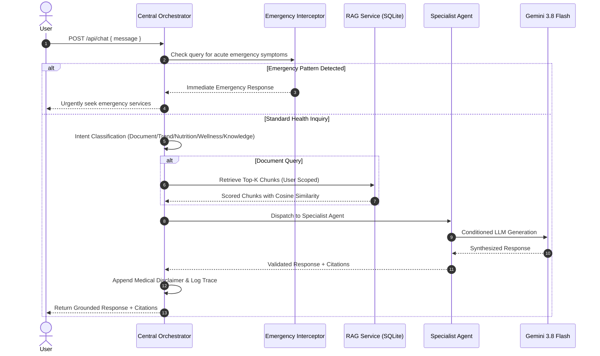

# Multi-Agent AI System Specification

## 1. Specialist Agents Breakdown

HealthMate AI distributes specialized reasoning tasks to five decoupled specialist agents rather than relying on an unconstrained single system prompt.

### Agent 1: Health Document Agent (`documentAgent.ts`)
- **Primary Mission:** Interpret uploaded clinical documents and lab reports.
- **Data Source:** Persistent SQLite vector chunks retrieved via cosine similarity.
- **Operational Logic:**
  - Evaluates user query against indexed report chunks.
  - Formats grounded citations attributing findings to specific uploaded documents.
  - Preserves laboratory reference intervals and flags deviations neutrally.
  - Enforces non-diagnostic policy.

### Agent 2: Health Trend Analysis Agent (`trendAgent.ts`)
- **Primary Mission:** Detect physiological patterns and trajectory across historical measurements.
- **Data Source:** User measurements table (`measurements`).
- **Operational Logic:**
  - Invokes `compareMeasurements` tool to deterministically compute baseline vs current values, net deltas, and percentage changes.
  - Distinguishes observed numerical variances from clinical diagnoses.

### Agent 3: Nutrition Agent (`nutritionAgent.ts`)
- **Primary Mission:** Formulate balanced, allergy-safe meal plans.
- **Data Source:** User nutrition preferences and physiological profile.
- **Operational Logic:**
  - Respects dietary choices: Vegetarian, Vegan, Non-Vegetarian, Jain, Eggetarian.
  - Incorporates regional Indian options (North Indian, South Indian, Maharashtrian, Gujarati, Bengali).
  - Enforces allergy exclusions (Peanuts, Tree nuts, Dairy, Gluten, Soy, Seafood, Eggs).
  - Uses `calculateNutritionTargets` tool for Mifflin-St Jeor daily energy expenditure.

### Agent 4: Wellness and Habit Agent (`wellnessAgent.ts`)
- **Primary Mission:** Coach sustainable daily lifestyle routines.
- **Data Source:** User habits table (`wellness_habits`).
- **Operational Logic:**
  - Tracks daily hydration, sleep hygiene, physical steps, and mindfulness.
  - Calculates completion percentages and streak counters.
  - Explicitly states that lifestyle coaching does not substitute professional psychological or psychiatric care.

### Agent 5: General Health Knowledge Agent (`knowledgeAgent.ts`)
- **Primary Mission:** Explain medical terminology, lab tests, and biological concepts.
- **Operational Logic:**
  - Translates clinical terms into plain English.
  - Highlights medical uncertainty and points users to qualified healthcare professionals.

---

## 2. Central Orchestrator Workflow

