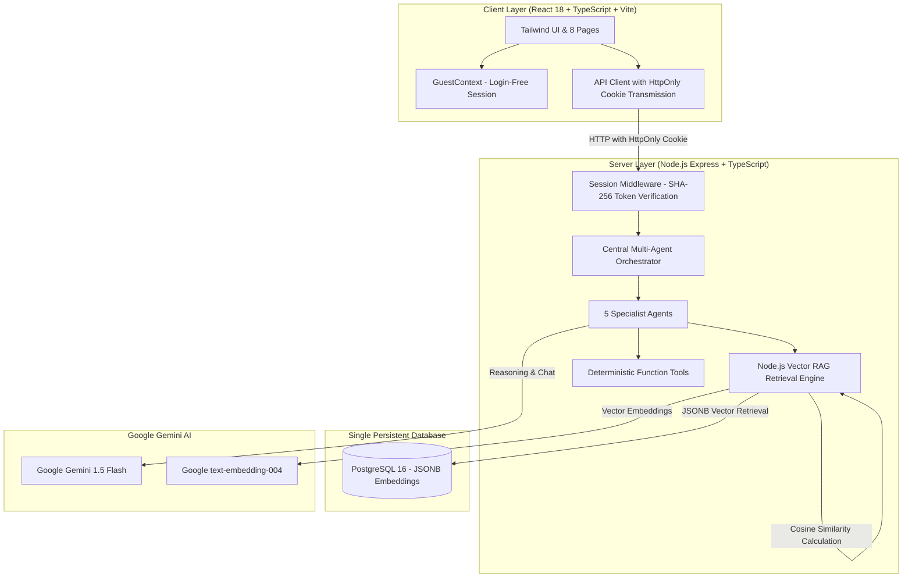

# HealthMate AI — Full-Stack System Architecture

## 1. High-Level Architecture Overview

HealthMate AI is designed as an enterprise-grade client-server application engineered for high clinical safety, data privacy, and explainable AI operations.

---

## 2. Key Architectural Tenets

1. **Single Persistent Database:** PostgreSQL 16 is the sole database engine. Dual-database synchronization complexities (Firebase, Firestore, SQLite) are completely eliminated.
2. **JSONB Vector Storage & Node.js Cosine Similarity:** Embeddings are stored in standard PostgreSQL `JSONB` columns, avoiding Windows C++ compilation requirements for `pgvector`. Vector cosine similarity is computed directly in Node.js.
3. **Zero-Barrier Access:** Users immediately land on the Dashboard without requiring authentication credentials. Cryptographically random session tokens are managed via HttpOnly cookies.
4. **Deterministic Medical Computation:** Calculations for BMI, MAP, and caloric targets are calculated in TypeScript and never left to probabilistic LLM inference.
5. **Immediate Emergency Interception:** Critical symptoms are intercepted before calling the LLM, returning immediate triage warnings.
6. **Complete Guest Isolation & Purge:** Multi-table cascading deletes guarantee that resetting a session permanently wipes all patient-scoped data from PostgreSQL.
