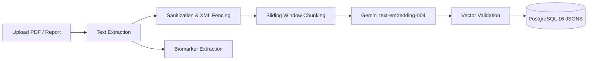

# Retrieval-Augmented Generation (RAG) Architecture with PostgreSQL 16 (JSONB Embeddings, No pgvector)

## 1. Overview
Retrieval-Augmented Generation (RAG) grounds Large Language Model responses in external, patient-specific medical documents. In HealthMate AI, RAG enables users to ask questions regarding their uploaded clinical laboratory reports without fine-tuning the model or hallucinating private biomarkers.

The architecture eliminates the need for compiling the `pgvector` C-extension on Windows workstations by utilizing PostgreSQL 16's native `JSONB` data type to store high-dimensional Gemini embeddings and calculating cosine similarity directly in Node.js.

---

## 2. Ingestion Pipeline



### 1. Document Extraction & Indirect Prompt Injection Defense
- Raw report text is extracted from uploaded clinical reports using `pdf-parse` (for PDF documents) and `tesseract.js` (for image OCR).
- Untrusted text is strictly enclosed in `<UNTRUSTED_PATIENT_DOCUMENT>` XML fences with system instructions disallowing system instruction overrides.

### 2. Semantic Chunking
- Text is split into semantic chunks with a sliding window overlap (e.g. ~400 words with 60 words overlap).
- Overlapping windows ensure that critical clinical statements spanning chunk boundaries retain full semantic coherence.

### 3. PostgreSQL JSONB Embedding Storage
- Chunk embeddings (768 dimensions) are generated server-side using Google Gemini model `text-embedding-004`.
- The embedding is inserted into the `document_embeddings` table in PostgreSQL as a validated `JSONB` array:
```sql
INSERT INTO document_embeddings (id, chunk_id, guest_id, embedding, dimensions, model, created_at)
VALUES ($1, $2, $3, $4::jsonb, 768, 'text-embedding-004', NOW());
```

---

## 3. Semantic Retrieval Pipeline

1. **User Query Embedding:** The user query is embedded into a 768-dimensional vector $\vec{Q}$ using `text-embedding-004`.
2. **Guest Scoped Vector Fetch:**
```sql
SELECT
  dc.id AS chunk_id,
  dc.document_id,
  hd.title AS document_title,
  dc.chunk_index,
  dc.content,
  de.embedding
FROM document_embeddings de
JOIN document_chunks dc ON de.chunk_id = dc.id
JOIN health_documents hd ON dc.document_id = hd.id
WHERE de.guest_id = $1 AND hd.guest_id = $1
LIMIT 1000;
```
3. **Application-Side Cosine Similarity Calculation:**
   Node.js computes the exact cosine similarity:
   $$\text{Similarity}(\vec{A}, \vec{B}) = \frac{\sum_{i=1}^n A_i B_i}{\sqrt{\sum_{i=1}^n A_i^2} \sqrt{\sum_{i=1}^n B_i^2}}$$
   - Handles zero vectors safely (returns 0.0).
   - Rejects NaN and infinite values.
   - Enforces vector dimension equality.
4. **Ranking & Top-K Selection:**
   Results are sorted in descending order of similarity, and the top-K chunks are injected into the Gemini prompt context.
5. **Data Isolation:**
   The SQL query filter `WHERE de.guest_id = $1 AND hd.guest_id = $1` ensures that no guest can ever view or retrieve another guest's document chunks.

---

## 4. Human-in-the-Loop Verification & Re-Indexing

1. When a report is uploaded, extracted biomarker values are initially marked as `unverified` (`verified = FALSE`).
2. The user can review, edit numerical values or units, and confirm lab values.
3. Upon confirmation (`POST /api/documents/:id/verify`), the document and values are updated to `verified = TRUE`.
4. The system automatically re-indexes the document chunks with a clinical verification stamp:
   `[USER VERIFICATION NOTE: All extracted laboratory values for this report have been reviewed and verified by the user.]`
   This ensures downstream LLM reasoning recognizes human verification.
